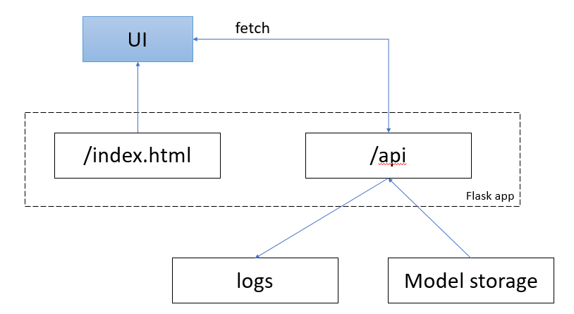

# Курс MLOps
Это учебный проект, направленный на создание модели машинного обучения для прогнозирования цен на жилье. 
Папка с [лекциями курса](https://drive.google.com/drive/folders/1HsI7IYoc-BrBrA6SRhxm1tzyCLtwnKht?usp=sharing).  
Модель использует различные характеристики объектов недвижимости для предсказания их рыночной стоимости.

### Архитектура сервиса 



### Как запустить
1. Клонируйте репозиторий:
```bash
git clone https://github.com/labintsev/mlops.git
```

2. Создайте venv и установите зависимости:
```bash
python -m venv venv
venv/Scripts/activate
pip install -r requirements.txt
```

4. Запустите сервис (модель по умолчанию берётся из `MODEL_NAME` в `.env`)
```sh
python service/app.py
# или с явным указанием модели из service/predict.py
python service/app.py -m baseline_const
```
Веб приложение доступно по ссылке `http://127.0.0.1:5000`
API endpoint доступен  по ссылке `http://127.0.0.1:5000/api/numbers`

Чтобы добавить новую модель, объявите функцию `def my_model(X): ...` в `service/predict.py`
и зарегистрируйте её в словаре `MODELS` — после этого её можно выбрать через `-m` / `MODEL_NAME`.

### Признаки
Используемые данные включают следующие характеристики:
* Площадь жилья
* Количество комнат
* Этаж квартиры
* Этажей в доме


## Данные и DVC

Исходные CSV-выгрузки Domclick находятся в `data/raw`, очищенные данные – в `data/processed/listings.csv`. Сами данные хранятся через DVC. В Git входят код обработки, `.dvc`-метаданные, `dvc.yaml` и `dvc.lock`.

### Окружение

Команды выполняются из корня репозитория с активированным окружением Python 3.11:

```sh
source .venv/bin/activate
```

Если DVC ещё не установлен:

```sh
python -m pip install dvc==3.67.1
```

Скрипту очистки достаточно стандартной библиотеки Python.

### Получение данных

Для текущей локальной настройки хранилище находится рядом с репозиторием, в `../.dvc-storage/mlops`:

```sh
dvc remote add --local -d local ../.dvc-storage/mlops
dvc pull
```

Команда настройки нужна один раз для каждого checkout. Путь сохраняется только в локальной конфигурации. На другом компьютере нужен доступ к копии этого хранилища либо собственный доступный remote: Git не содержит сами CSV.

### Обработка и обновление

```sh
dvc repro
```

DVC запускает очистку при изменении исходных CSV или скрипта. Без изменений повторный расчёт пропускается. Схема обработки записана в `dvc.yaml`.

Для следующих выгрузок сохранять отдельный CSV в `data/raw` с именем `domclick_YYYY-MM-DD_HH-MM.csv` (между датой и временем – подчёркивание), затем:

```sh
dvc add data/raw
dvc repro
dvc push
```

`dvc push` сохраняет данные в настроенное хранилище. Изменённые метаданные `data/raw.dvc` и `dvc.lock` фиксируются в Git отдельно от данных.

При повторном объявлении используется последняя корректная запись в лексикографическом порядке имён без расширения, а не по времени изменения файла. Текущая обычная выгрузка обрабатывается перед `-large`. Для следующего сбора в тот же день имя с `_HH-MM` сортируется после обоих текущих файлов. Другие произвольные суффиксы не использовать. Исходные файлы не изменяются.

### Правила очистки

- Полная цена берётся из отдельной колонки. Ипотечный платёж и цена за м² не подставляются вместо неё.
- Исключаются явные группы предложений: цена «от», диапазоны площади или этажей, отдельная подпись о нескольких предложениях.
- Нужны распознанные id, комнаты, площадь, этаж, этажность и положительная полная цена. Этаж должен находиться в пределах здания.
- Квартиры и апартаменты сохраняются с отдельным признаком типа. Студия кодируется нулём комнат.
- После объединения выгрузок исключаются возможные повторы объекта: совпадают адрес, комнаты, площадь, этаж, этажность и тип. Сохраняется запись с меньшим числовым ID; цена в сравнении не участвует. Причина исключения – `duplicate_object`. Без адреса это правило не применяется. Одинаковые квартиры в одном доме могут ошибочно считаться повтором.
- Контакты продавца, описания, фотографии и цена за м² в очищенную таблицу не включаются. Адрес и ссылка остаются для проверки происхождения и местоположения.

Структура конкретной выгрузки задаётся названиями колонок в `scripts/prepare_data.py`. При изменении заголовков скрипт сообщает об ошибке. Неоднозначные или сдвинутые значения не угадываются.

Файлы результата:

- `listings.csv` – очищенные записи;
- `excluded.csv` – исключённые строки с причиной и номером записи в исходном CSV;
- `summary.json` – количество строк и причины исключения.

Статистика текущего запуска находится в `summary.json`. Проверка формата и согласованности полей не подтверждает достоверность объявлений.

`core.autostage` включать не обязательно. Он автоматически добавляет изменённые DVC-метаданные в Git staging, но не создаёт коммиты. Здесь используется явное добавление файлов перед коммитом.

Проверки правил очистки:

```sh
python -m unittest discover -s tests
```

## Содержание курса

### Тема 1. Введение в MLOps
* Введение в MLOps
* Бизнес анализ
* Дизайн документ

### Тема 2 Data Ops
* Форматы и модели данных
* Настройка конвеера сбора данных
* Отбор и разметка данных. Несбалансированные выборки
* Аугментация данных
* Предварительная обработка  признаков

### Тема 3 Model Ops

* Разделение выборки и утечка данных
* Постановка задачи ML
* Виды моделей ML и рекомендации по выбору
* Выбор функции потерь
* Ансамбли моделей
* Разработка, трекинг и логирование
* Mlflow: сценарии, архитектура, альтернативы
* Auto ML
* Распределенное обучение
* Офлайн оценка
* Оценка подмножеств (срезов) данных

### Тема 4 Dev Ops
* Разработка моделей предиктивной аналитики и оценка метрик
* Внедрение моделей в бизнес
* Инфраструктура инференса моделей


### Тема 5 LLM Ops

* Модель, промпты и данные
* RAG и оценка качества
* Развертывание и мониторинг

## Защита семинаров

Отчет по семинарам сдается в личной беседе. 
Под каждую тему заводите отдельныую ветку, merge в main через pull request. 
Ветки после PR не удалять! 

1. Разработка дизайн документа
2. Внедрение DVC
3. Внедрение MLflow
4. Внедрение дашборда мониторинга, CI/CD github actions
5. Внедрение чата Haystack + Ollama

## Обучение и MLflow

Команды выполняются из корня репозитория в активированном окружении:

```sh
source .venv/bin/activate
dvc repro
python scripts/split_data.py
python train.py --model baseline
python train.py --model linear
python train.py --model ridge --alpha 100
```

Этапы запускаются отдельно. Для повторного обучения достаточно последней нужной команды. При смене данных сначала нужно повторить разбиение.

Разбиение 60/20/20 с seed 42 сохраняется в `runs/split.csv`; хеш исходного CSV и размеры частей – в `runs/split.json`. Обучение проверяет, что версия данных соответствует разбиению.

Baseline – медиана исходных цен train. Регрессии используют масштабирование признаков и логарифм цены. Сохранённая модель включает обратное преобразование и возвращает рубли. По умолчанию используется legacy: семь признаков в том же порядке и по тем же правилам, что в сервисе.

Отдельные эксперименты с комнатностью:

```sh
python train.py --model ridge --alpha 100 --rooms-encoding numeric
python train.py --model ridge --alpha 100 --rooms-encoding categorical
python train.py --model ridge --alpha 100 --rooms-encoding numeric --include-floor
```

В numeric количество комнат передаётся числом, в categorical используются флаги студия/1/2/3/4+. Остальные признаки сохраняются. Имена запусков включают схему комнатности, параметр `rooms_encoding` позволяет группировать результаты. Эти две схемы пока не подключены к сервису: набор входных колонок отличается от legacy.

Флаг `--include-floor` добавляет числовой этаж. Этажность дома и флаги первого/последнего этажа сохраняются. Параметр `include_floor` записывается в MLflow, имя запуска получает суффикс floor=numeric.

Один вызов train.py создаёт один запуск MLflow: модель, параметры, validation MAE, RMSE, R² и MAPE в процентах. Также сохраняются разбиение, DVC-метаданные, исходный код обучения и validation-прогнозы. После сохранения проверяется совпадение прогнозов загруженной модели. Выбор регрессии делается по validation MAE; тестовая оценка выполняется отдельно после выбора.

Для тестовой оценки выбранного запуска:

```sh
python evaluate.py --run-id RUN_ID
```

Вместо RUN_ID указать ID из MLflow. Скрипт загружает сохранённую модель, проверяет версию данных и разбиения, восстанавливает признаки из параметров запуска. Переобучение не выполняется. В исходный запуск добавляются метрики `test_*`, число тестовых строк и таблица прогнозов. Локальные файлы сохраняются в `runs/RUN_ID/test_result.json` и `test_predictions.csv`. На test оцениваются baseline и выбранная по validation модель; остальные варианты на test не подбираются.

Просмотр экспериментов:

```sh
mlflow ui --backend-store-uri sqlite:///.mlflow/mlflow.db --host 127.0.0.1 --port 5051
```

Открыть http://127.0.0.1:5051 и эксперимент `domclick_price`. База и артефакты находятся в `.mlflow/`, локальные результаты – в `runs/`; обе папки исключены из Git. Для сохранения истории экспериментов нужна копия `.mlflow/`. DVC-хранилище содержит данные, но не эту историю.

Пути к артефактам в базе абсолютные. При восстановлении копии в другую папку или на другой компьютер ссылки могут потребовать корректировки.

## Проверка Python-кода

В активированном окружении:

```sh
python -m pip install -r requirements-dev.txt
ruff check train.py evaluate.py scripts tests
ruff format --check train.py evaluate.py scripts tests
ty check train.py evaluate.py scripts tests
```

Правила Ruff записаны в ruff.toml: импорты, базовые ошибки, современный синтаксис Python 3.11 и аннотации функций. Совместимость типов отдельно проверяет ty.

## Лицензирование
Этот проект распространяется под лицензией MIT. 
Смотрите файл LICENSE для деталей.

## Контакты
Для вопросов и предложений обращайтесь:
* Email: ailabintsev@fa.ru
